# 📦 CargoTrack - Kurumsal Kargo Takip Platformu

Modern bir **ASP.NET Core 8.0 MVC** uygulaması ile inşa edilmiş, **N-katmanlı (N-Layer)** mimariye sahip tam işlevli bir **kargo takip ve operasyon yönetim platformu**. **Entity Framework Core**, **SQL Server**, **ASP.NET Core Identity**, **Repository Pattern**, **Mapster** ve **FluentValidation** ile geliştirilmiştir. Kod isimleri İngilizce, tüm arayüz metinleri Türkçedir.

---

## 📋 Proje Özellikleri

### 🎯 Ana Özellikler

- **🔎 Public Kargo Takip** - Takip numarası ile giriş gerektirmeden durum, güzergâh ve hareket geçmişi
- **🗺️ Canlı Harita Takibi** - Leaflet + OpenStreetMap ile çok duraklı rota (çıkış → ara transfer merkezleri → güncel konum); API anahtarı gerekmez
- **📬 Müşteri Teslimat Tercihi** - Kargo **Dağıtıma Çıktı** olduğunda müşteri panelinden **Adresteyim**, **Komşuma Teslim Et** (adres zorunlu) veya **Başka Bir Güne Randevu** (tarih seçici); tercih bir kez kaydedilir
- **🔐 Rol Bazlı Paneller** - **Admin** (tüm operasyon), **Manager** (kendi şubesi), **User** (gönderdiği/aldığı kargolar)
- **📊 Dashboard & Raporlar** - KPI kartları, durum dağılımı, şube/personel performansı, teslimat ve iade oranları
- **💰 Dinamik Fiyatlandırma** - Desi = En × Boy × Yükseklik / 3000; ağırlık/desi ve teslimat tipine (Standart / Ekspres / Aynı Gün) göre ücret + farklı şehir farkı
- **🔁 Durum Makinesi** - Kargo yaşam döngüsü iş kurallarıyla kısıtlı geçişler (oluşturma → şube → transfer → dağıtım → teslim / iade)
- **🧾 Denetim Kayıtları** - Kritik işlemler (oluşturma, güncelleme, durum değişimi, teslimat tercihi) audit log’a yazılır
- **🛠️ Yönetim** - Şube, transfer merkezi, personel, fiyat kuralı, kullanıcı-rol atama ve kurumsal içerik CRUD’u

### 🔧 Teknoloji Stack

| Teknoloji | Versiyon | Açıklama |
|-----------|----------|----------|
| **.NET** | 8.0 | Microsoft .NET framework |
| **ASP.NET Core MVC** | 8.0 | Web uygulama çatısı (Areas: Admin / Manager / User) |
| **Entity Framework Core** | 8.0.30 | ORM (Code-First + Migrations) |
| **SQL Server** | Express | İlişkisel veritabanı |
| **ASP.NET Core Identity** | 8.0 | Cookie tabanlı kimlik doğrulama, rol yetkilendirme |
| **Mapster** | 10.0.12 | Entity ↔ DTO eşleme |
| **FluentValidation** | 11.3.1 | DTO doğrulama kuralları |
| **Leaflet.js** | 1.9.4 | Harita üzerinde rota takibi (OpenStreetMap) |
| **Tailwind CSS** | CDN | Public / müşteri arayüzü |
| **Bootstrap** | 5 | Admin / Manager panel layout |

---

## 🏗️ Mimari

Proje klasik **N-Layer + Repository Pattern** kullanır; her domain’in kendi repository ve servisi vardır (generic servis yok).

```
┌──────────────────────────────────┐
│         CargoTrack.WebUI          │
│   MVC + Areas + Identity Cookie   │
└────────────────┬─────────────────┘
                 │ I*Service
┌────────────────▼─────────────────┐
│        CargoTrack.Business        │
│  Servisler, FluentValidation,     │
│  fiyat/SLA, durum makinesi        │
└────────────────┬─────────────────┘
                 │ I*Repository
┌────────────────▼─────────────────┐
│       CargoTrack.DataAccess       │
│  EF Core, GenericRepository<T>,   │
│  spesifik repository’ler          │
└────────────────┬─────────────────┘
                 │
┌────────────────▼─────────────────┐
│  CargoTrack.Entity  │  CargoTrack.DTO
│  Domain + Enums     │  Transfer nesneleri
└──────────────────────────────────┘
                 │
                 ▼
          SQL Server (CargoTrack)
```

- **Entity** → `BaseEntity` (Guid Id, CreatedDate, UpdatedDate, IsDeleted) + global query filter (soft delete)
- **DataAccess** → `IRepository<T>` / `GenericRepository<T>` + kargo, hareket, teslimat vb. özel repository’ler
- **Business** → domain servisleri (`ICargoService`, `IDashboardService`, …), Mapster, FluentValidation
- **WebUI** → public sayfalar + rol panelleri; İngilizce kod, Türkçe UI

---

## 🗄️ Veritabanı Şeması

Proje **SQL Server** üzerinde **EF Core Code-First** ve **Migration** kullanır.

```
📊 Veritabanı: CargoTrack (SQL Server)

├── Cities / Branches / TransferCenters
│
├── AspNetUsers / AspNetRoles          → Identity (Admin, Manager, User)
├── Addresses                          → Kullanıcı adresleri (il-ilçe tutarlı)
├── Employees                          → Şubeye bağlı personel
│
├── CargoPrices                        → Teslimat tipine göre tarife
├── Cargos                             → Takip no, ölçü, desi, ücret, durum,
│   │                                    teslimat tercihi / komşu adresi / randevu
│   ├── → FK: SenderId / ReceiverId (AppUser)
│   └── → FK: Origin / Destination / Current Branch, TransferCenter
│
├── CargoMovements                     → Durum geçişleri + LocationCity (harita)
├── Deliveries                         → Teslimat kodu / onay
├── DeliveryExceptions                 → Başarısız teslim denemeleri
│
├── AuditLogs                          → Kim, ne, hangi varlık
└── Abouts / ContactInfos              → Kurumsal içerik
```

**Kargo durumları:** Oluşturuldu → Gönderici Şubesinde → Transfer Merkezinde → Varış Şubesinde → Dağıtıma Çıktı → Teslim Edildi *(alternatif: Teslim Edilemedi → İade)*

---

## 🚀 Başlangıç

### Gereksinimler

- [.NET 8.0 SDK](https://dotnet.microsoft.com/download)
- [SQL Server](https://www.microsoft.com/sql-server) (Express yeterli) + SSMS veya `sqlcmd`
- Visual Studio 2022 (önerilen profil: **http**) / VS Code

### Kurulum Adımları

#### 1. Depoyu Klonlayın

```bash
git clone https://github.com/cemreeryilmaz/CargoTrack.git
cd CargoTrack
```

#### 2. Veritabanı Bağlantısını Yapılandırın

`CargoTrack.WebUI/appsettings.Development.json` içindeki bağlantı dizesini kendi SQL Server örneğinize göre güncelleyin:

```json
{
  "ConnectionStrings": {
    "DefaultConnection": "Server=SUNUCU_ADI\\SQLEXPRESS;Initial Catalog=CargoTrack;Integrated Security=true;TrustServerCertificate=True;"
  }
}
```

#### 3. Migrasyonları Uygulayın

İlk açılışta uygulama bekleyen migrasyonları kendisi uygular. Elle çalıştırmak için (projeyle uyumlu EF 8 aracı):

```bash
dotnet tool restore
dotnet dotnet-ef database update --project CargoTrack.DataAccess --startup-project CargoTrack.WebUI
```

#### 4. Örnek Veriyi Yükleyin (250’şer kayıt + çok duraklı rotalar)

```bash
sqlcmd -S "SUNUCU_ADI\SQLEXPRESS" -d CargoTrack -E -i "CargoTrack.WebUI/SeedData/CargoTrack_250_SeedData.sql"
sqlcmd -S "SUNUCU_ADI\SQLEXPRESS" -d CargoTrack -E -i "CargoTrack.WebUI/SeedData/CargoTrack_Enrichment_Routes.sql"
```

- İlk script tabloları **250 satıra** tamamlar (mevcut veriyi korur, FK bütünlüğü sağlar).
- İkinci script **çok duraklı şehir rotaları** üretir ve **50+ kargoyu Dağıtıma Çıktı** durumuna çeker (müşteri teslimat seçeneklerinin testi için).

#### 5. Uygulamayı Çalıştırın

Visual Studio’da başlangıç projesi **CargoTrack.WebUI**, profil **http** olsun → **F5**.

veya terminalde:

```bash
dotnet run --project CargoTrack.WebUI --launch-profile http
```

Uygulama: **http://localhost:5235**

> **İpucu:** Başka bir `dotnet run` süreci DLL’leri kilitlerse Visual Studio derleyemez; çalışan `CargoTrack.WebUI` süreçlerini kapatın. IIS Express yerine **http** (Kestrel) profilini kullanın.

### 🔑 Demo Hesaplar

Tüm seed kullanıcılarının parolası admin ile aynıdır: **`Admin123!`**

| Rol | Kullanıcı adı | Parola | Ne görür? |
|-----|---------------|--------|-----------|
| **Admin** | `admin` | `Admin123!` | Tüm kargolar, raporlar, şube/personel/fiyat/rol |
| **Müşteri** | `musteri200` | `Admin123!` | Kendi kargoları + harita + teslimat tercihleri |
| **Müşteri** | `musteri187` | `Admin123!` | Örn. `MYC-2026-100002` (İstanbul → Çankırı rotası) |

Dağıtıma çıkmış örnek takip: **`MYC-2026-100004`** (public takip veya `musteri200` paneli).

---

## 🎥 Ekran Görüntüleri

### 1. Ana Sayfa (Kargo Takip)
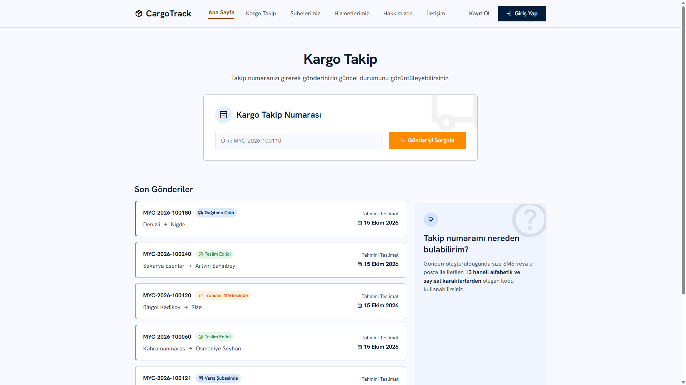

### 2. Public Takip — Çok Duraklı Rota + Harita
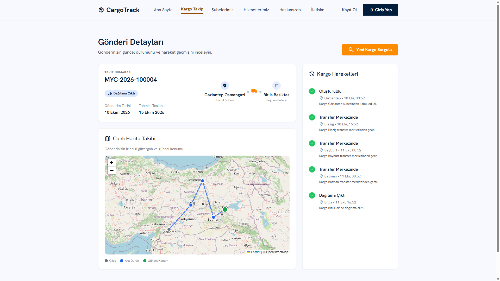

### 3. Müşteri Paneli
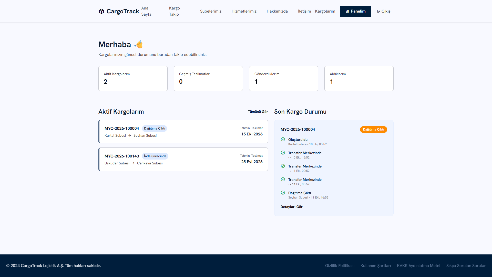

### 4. Kargo Detayı — Harita ve Hareket Geçmişi
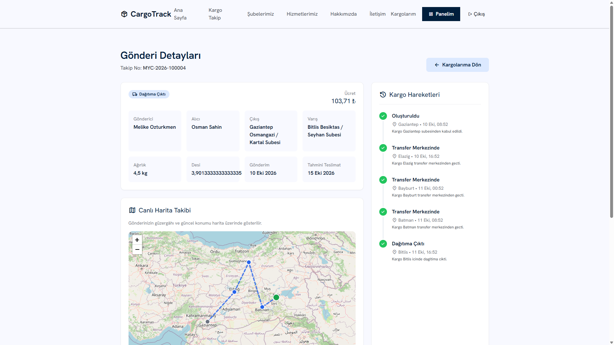

### 5. Teslimat Tercihleri (Dağıtıma Çıktığında)
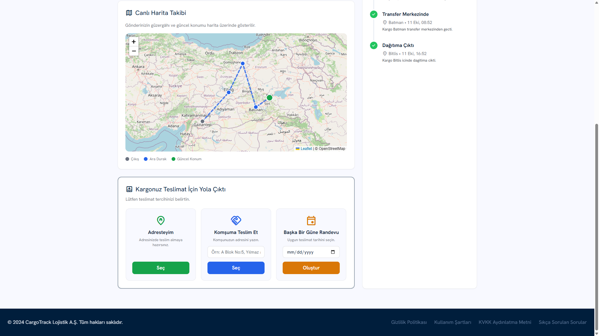

### 6. Yönetici Paneli (Dashboard)
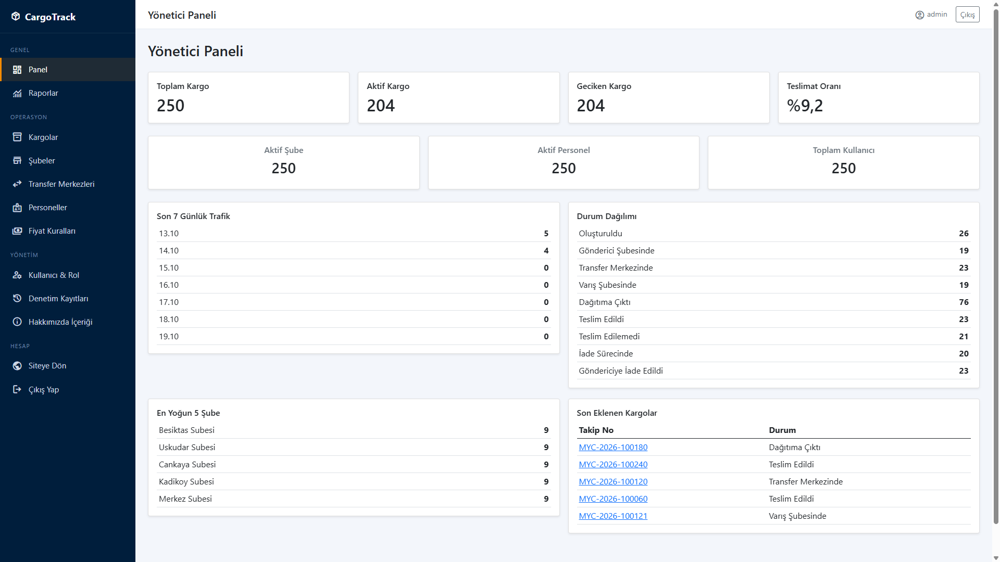

### 7. Kargo Yönetimi
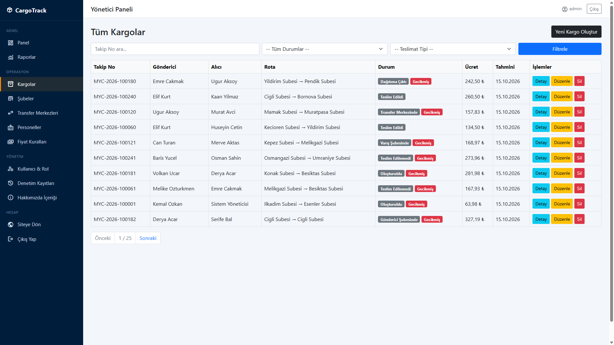

### 8. Performans Raporları
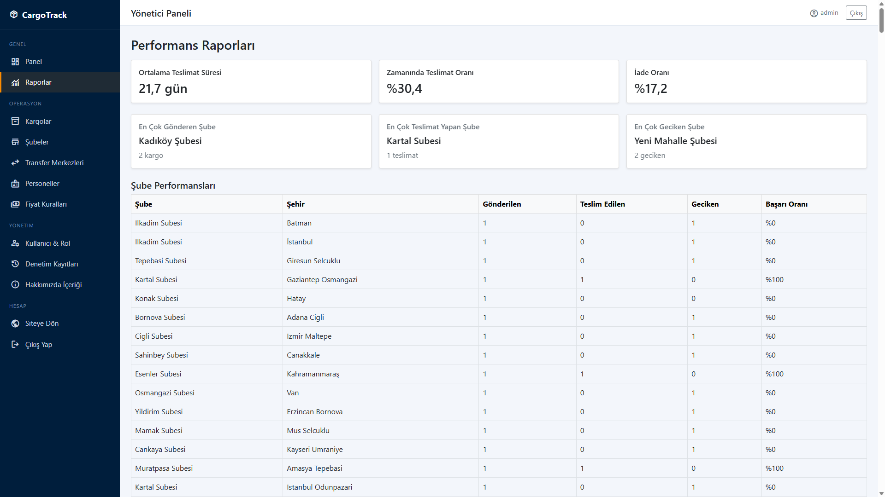

### 9. Şubelerimiz
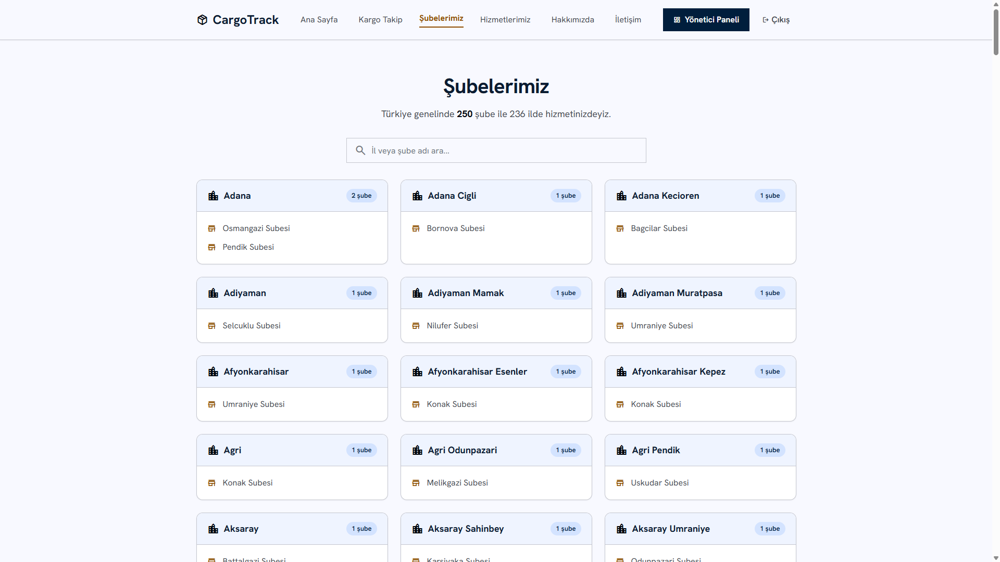

### 10. Hizmetlerimiz
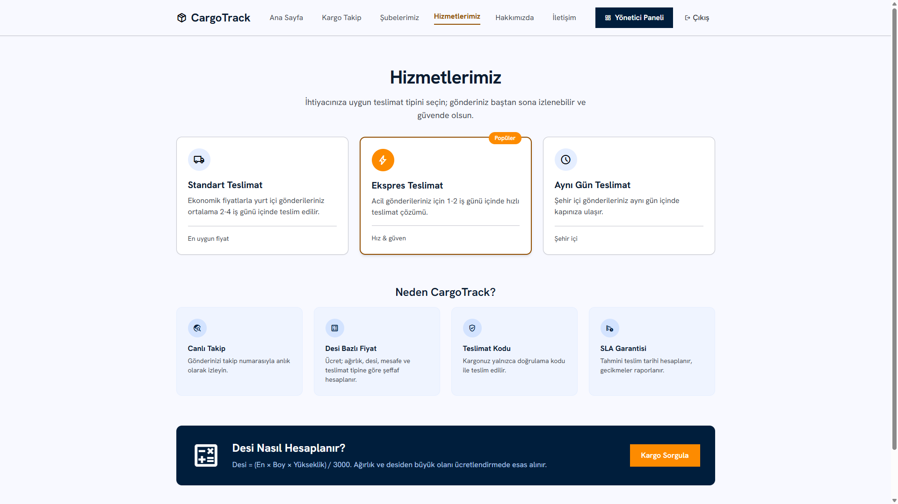

### 11. Yönetici — Kargo Detayı ve Hareketler
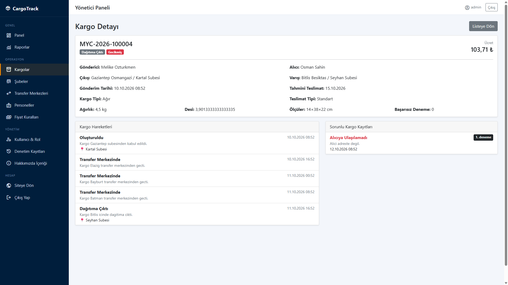

### 12. Yeni Kargo Oluşturma
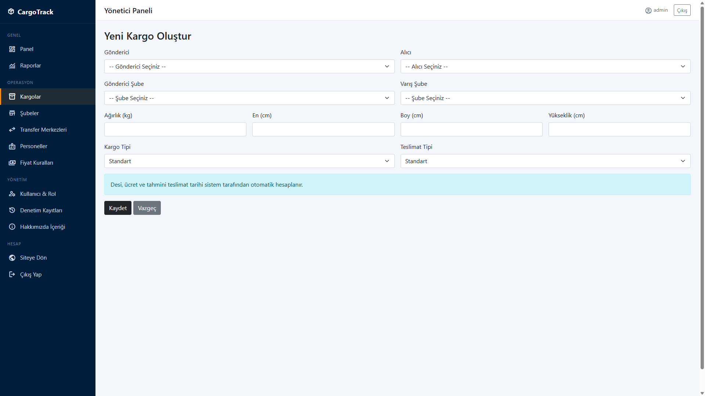

### 13. Personel Yönetimi
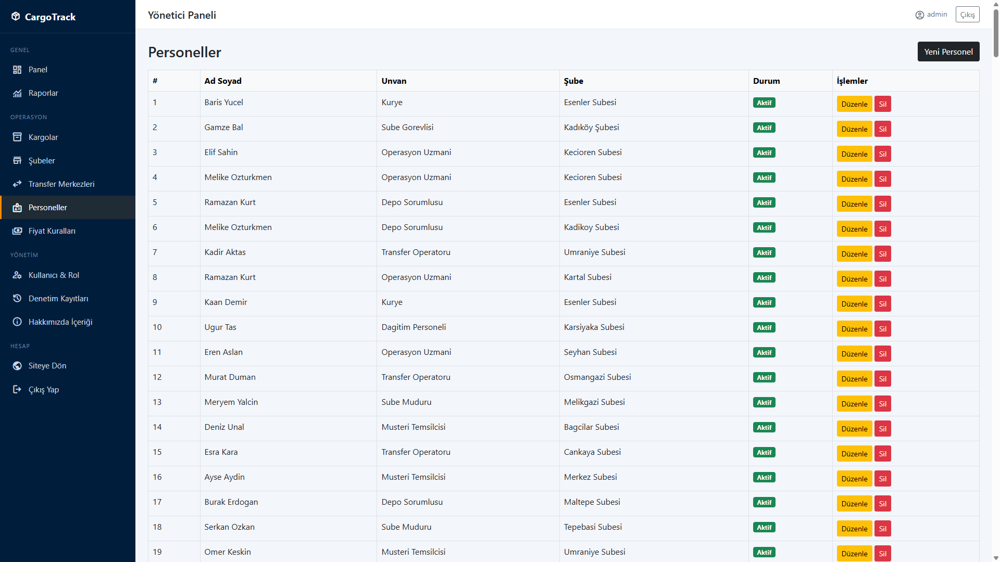

### 14. Fiyat Kuralları
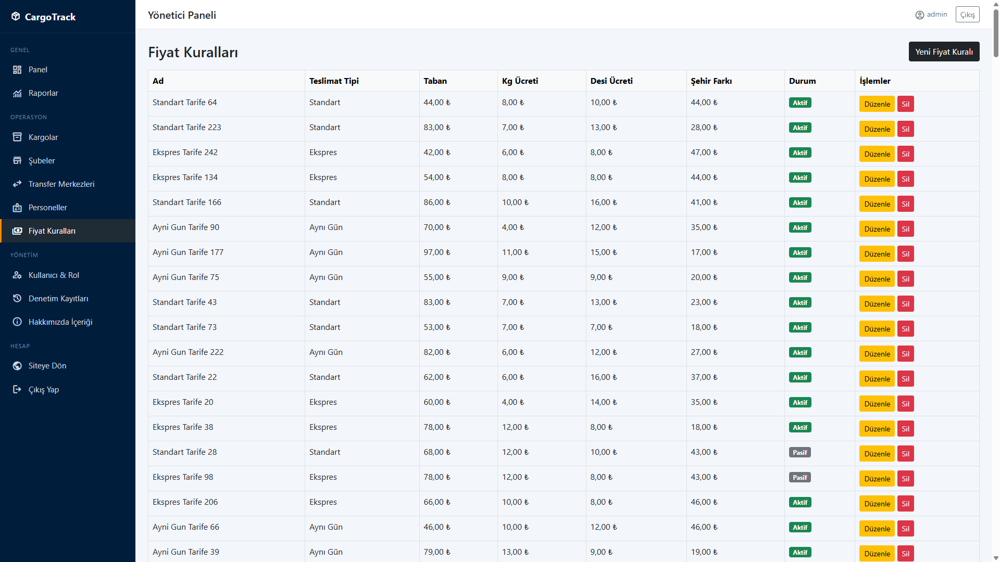

### 15. Denetim Kayıtları (Audit Log)
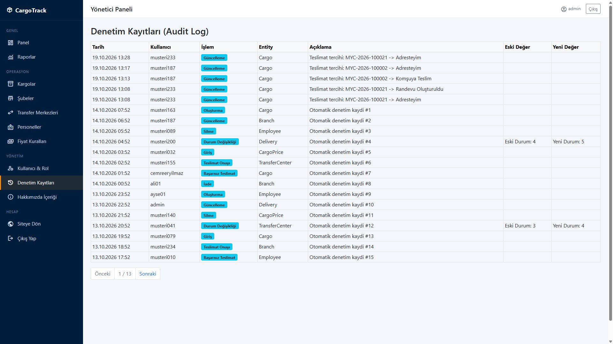

---

## 📁 Proje Yapısı

```
CargoTrack/
├── CargoTrack.Entity/                 # Domain
│   ├── Entities/                      # Cargo, CargoMovement, Branch, Employee, ...
│   ├── Entities/Enums/                # CargoStatus, DeliveryType, DeliveryPreference, ...
│   └── Extensions/EnumExtensions.cs   # [Display] → Türkçe ad
│
├── CargoTrack.DTO/                    # Create / Update / Result / Detail DTO’ları
│
├── CargoTrack.DataAccess/
│   ├── Context/CargoTrackDbContext.cs
│   ├── Repositories/                  # Generic + spesifik (Cargos, Movements, ...)
│   └── Migrations/
│
├── CargoTrack.Business/
│   ├── Services/                      # ICargoService, Dashboard, Pricing, Reports, ...
│   └── Validators/                    # FluentValidation
│
├── CargoTrack.WebUI/
│   ├── Areas/Admin|Manager|User/      # Rol panelleri
│   ├── Controllers/                   # Default (public), Login, Register
│   ├── Views/Shared/_CargoRouteMap.cshtml
│   ├── SeedData/
│   │   ├── CargoTrack_250_SeedData.sql
│   │   └── CargoTrack_Enrichment_Routes.sql
│   └── Program.cs                     # DI, Identity, migration + admin seed
│
├── screenshots/                       # README ekran görüntüleri
└── README.md
```

---

## 🛠️ Başlıca Uç Noktalar

### Public
- `GET  /Default/Index` - Ana sayfa + son gönderiler
- `GET  /Default/CargoDetails?trackCode=` - Haritalı takip
- `GET  /Default/Branches` · `/Services` · `/About` · `/Contact`

### Müşteri (`User`)
- `GET  /User/Dashboard` · `/User/Cargo` · `/User/Cargo/Detail/{id}`
- `POST /User/Cargo/AtAddress` · `DeliverToNeighbor` · `CreateAppointment`

### Yönetici (`Admin`)
- `GET  /Admin/Dashboard` · `/Admin/Cargo` · `/Admin/Report`
- `GET  /Admin/Branch` · `/TransferCenter` · `/Employee` · `/CargoPrice`
- `GET  /Admin/RoleAssign` · `/AuditLog` · `/About`

### Şube müdürü (`Manager`)
- `GET  /Manager/Dashboard` · `/Manager/Cargo` · `/Manager/Cargo/Distribution`

---

## 📝 Kod Örnekleri

### Desi ve Ücret

```csharp
public double CalculateDesi(double width, double height, double length)
{
    var desi = (width * height * length) / 3000.0;
    return Math.Round(desi, 2);
}
```

### Durum Makinesi

```csharp
[CargoStatus.AtDestinationBranch] = new() { CargoStatus.OutForDelivery },
[CargoStatus.OutForDelivery]      = new() { CargoStatus.Delivered, CargoStatus.DeliveryFailed },
[CargoStatus.DeliveryFailed]      = new() { CargoStatus.OutForDelivery, CargoStatus.InReturnProcess },
```

---

## 🎓 Öğrenme Kaynakları

Bu proje aşağıdaki konular için iyi bir örnektir:

- ✅ ASP.NET Core 8.0 **N-Layer MVC** ve **Areas**
- ✅ **Repository Pattern** (`IRepository<T>` + domain repository’ler)
- ✅ **EF Core** Code-First, Migration, soft delete, lazy loading
- ✅ **Identity** ile rol bazlı yetkilendirme (Admin / Manager / User)
- ✅ **Mapster** ve **FluentValidation**
- ✅ Kargo **durum makinesi** ve iş kuralı katmanı
- ✅ Leaflet ile harita üzerinde rota gösterimi
- ✅ Deterministik SQL seed (250 satır + çok duraklı hareketler)

---

<div align="center">

**⭐ Bu projeyi yararlı bulduysanız, lütfen star vermeyi unutmayın! ⭐**

Made with ❤️ using ASP.NET Core & SQL Server

</div>
